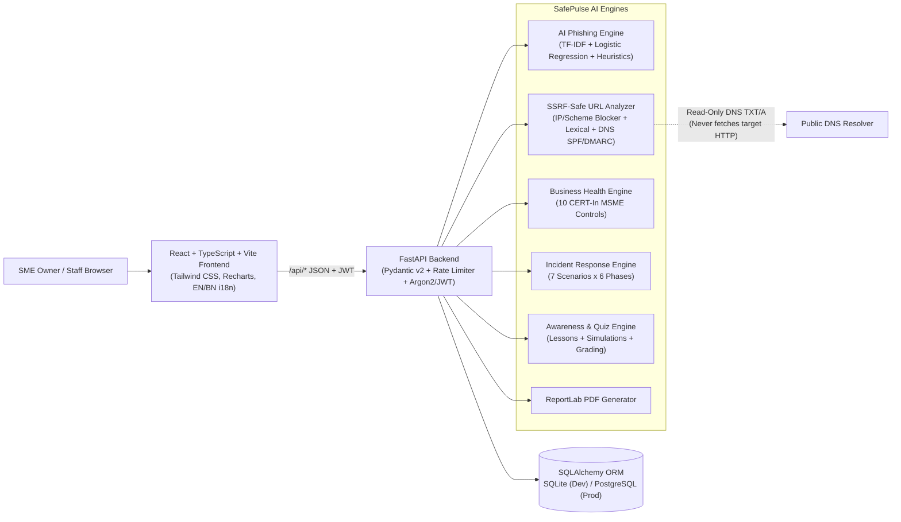

# SafePulse AI — System Architecture

## Architecture Diagram

## Security & Isolation Boundaries

1. **Tenant & Business Isolation**: Every query on `PhishingAnalysis`, `URLScan`, `SecurityAssessment`, `Incident`, `QuizResult`, and `AuditLog` is strictly scoped to `business_id` belonging to the authenticated `user.id`.
2. **SSRF Protection**: `url_analyzer.py` restricts schemes to `http`/`https`, rejects `localhost`, `.local`/`.internal` suffixes, and all private, loopback, link-local (`169.254.0.0/16`), multicast, and reserved IPv4/IPv6 ranges before and after DNS resolution. It never opens an HTTP connection to the submitted target URL.
3. **Authentication & Secrets**: Passwords are hashed using `argon2-cffi` (`PasswordHasher`). Sessions use signed HS256 JWT tokens with expiration. Sliding-window rate limiting guards authentication and analysis routes.
4. **Database Schema (11 Relational Tables)**: `users`, `businesses`, `phishing_analyses`, `url_scans`, `security_assessments`, `assessment_answers`, `incidents`, `incident_checklist_items`, `awareness_quizzes`, `quiz_results`, `audit_logs`.

